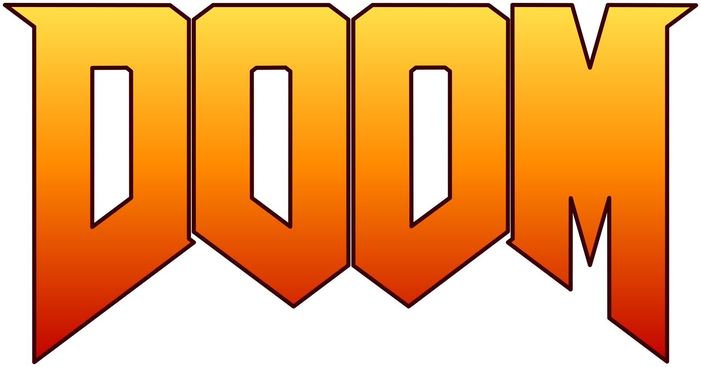
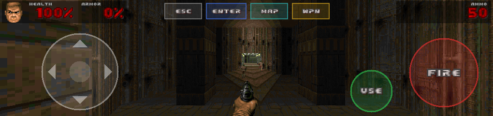
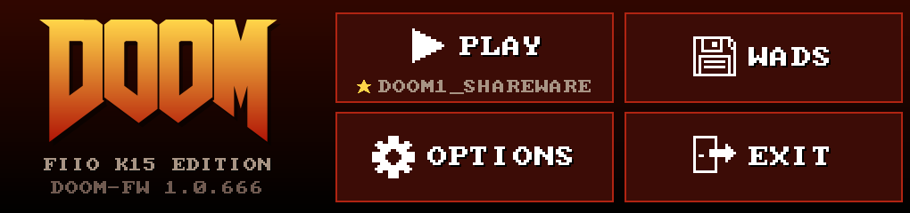
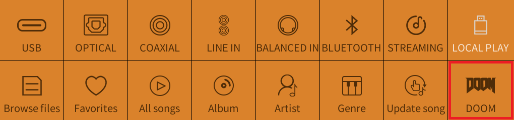
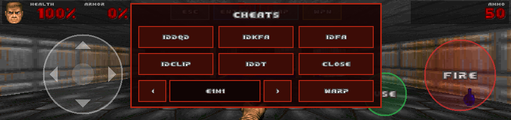

<h1 align="center">FiiO K15 ·  Edition</h1>

<p align="center">
  <b>Custom firmware builder for running DOOM on the FiiO K15</b><br>
  <sub>Your DAC still does DAC things in between.</sub>
</p>

<p align="center">
  <a href="https://www.youtube.com/watch?v=agoL8goGUv4" title="Watch on YouTube: powering on the K15 and starting DOOM">
    
  </a>
  <br><br>
  <a href="https://www.youtube.com/watch?v=agoL8goGUv4">
    
  </a>
  <br>
  <a href="docs/README.md">
    
  </a>
</p>

<br>

<p align="center">
  The FiiO K15 is a very nice desktop DAC.<br>
  It has a dual-core MIPS chip running Linux and a 1020×240 touchscreen.<br>
  It plays music beautifully.<br>
  <i>It does not, out of the box, play DOOM.</i>
</p>

<h3 align="center">We fixed that.</h3>

<p align="center">
  This repository turns the official FiiO K15 v159 update (which you download yourself)<br>
  into the same firmware <b>plus DOOM</b>.<br>
  Flash it from a USB stick, tap the new DOOM tile, <b><i>rip and tear</i></b>.
</p>

<p align="center">
  
  
  
  
</p>

## Features

- **A DOOM tile** in the source grid, and a **DOOM entry** in the volume-knob input carousel.
- **True widescreen**: the full 1020-pixel-wide screen, with a HUD made from the WAD's own art.
- **Sound effects and OPL music** through the K15's own DAC. Yes, the AK4497s. For DOOM. We have not A/B-tested the shotgun against a $500 cable.
- **Touch controls** with four layouts, plus **USB keyboards and gamepads** (XInput too), hot-pluggable.
- **A WAD manager**: play WADs from a USB stick or install them on the K15. DOOM, DOOM II, Final DOOM, [Freedoom](https://freedoom.github.io/), add-on PWADs.
- **A cheat menu**, because nobody has time to type `iddqd` on a touchscreen.
- **A DOOM boot animation** (pick one of four, or keep FiiO's).
- **Bring your own firmware and WAD**: no FiiO code and no game data in this repository. Cables sold separately; the BFG is built in.

## TL;DR

You need Docker, FiiO's official v159 zip and a FAT32/exFAT USB stick:

```sh
./build.sh ~/Downloads/K15_update_20261012_v159.zip   # Windows: .\build.ps1 <zip>
# copy out/K15_update_*_v160.zip (plus a .wad) to the root of the stick
# K15: Settings → Others → FW update → SOC local upgrade
```

Then tap the DOOM tile. The [getting started guide](docs/README.md) has the details.

## Get going

<table>
  <tr>
    <td width="33%" valign="top">
      <h3><a href="docs/README.md">🚀 Getting started</a></h3>
      From the official firmware to DOOM in a few steps.
    </td>
    <td width="33%" valign="top">
      <h3><a href="docs/technical/README.md">🔧 Technical</a></h3>
      How it works, and how we developed it live over Wi-Fi.
    </td>
    <td width="33%" valign="top">
      <h3><a href="docs/faq.md">❓ FAQ</a></h3>
      "Why?", "will it break?" and friends.
    </td>
  </tr>
</table>

> [!WARNING]
> No warranty, not affiliated with FiiO or id Software. Read [SECURITY.md](SECURITY.md) before you flash.

<p align="center"><sub>Licensed under the <a href="COPYING">GNU GPL v2</a>. "DOOM" is a trademark of id Software / ZeniMax.</sub></p>
