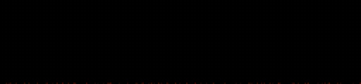

# Building

You need **Docker** and FiiO's official **v159** update. That's it. The build runs in a container, so you don't install compilers, Python packages or anything else.

## Simple guide

### 1. Download the official firmware

Get FiiO's K15 update **`K15_update_20261012_v159.zip`** from the FiiO forum:

<https://forum.fiio.com/note/showNoteContent.do?id=202511212008303270485&tid=17>

If that link is dead, FiiO has probably deleted the forum post. The builder only accepts v159 (it checks), so a newer or older zip won't work.

Don't unzip it.

### 2. Install Docker

- **Linux:** [Docker Engine](https://docs.docker.com/engine/install/). Your user needs to be able to run `docker` (the `docker` group, or rootless Docker).
- **macOS and Windows:** [Docker Desktop](https://docs.docker.com/desktop/). On Windows, keep it in its default *Linux containers* mode.

Start Docker before you build.

### 3. Get this repository

Clone it with git, or download it as a zip from GitHub and unpack it.

### 4. Build

Open a terminal in the repository folder and run one command. Pick your system:

<details open>
<summary><b>Linux / macOS</b></summary>

```sh
./build.sh ~/Downloads/K15_update_20261012_v159.zip
```

</details>

<details>
<summary><b>Windows (PowerShell)</b></summary>

```powershell
.\build.ps1 $HOME\Downloads\K15_update_20261012_v159.zip
```

If PowerShell refuses to run the script, see [the execution-policy tip](#windows-execution-policy).

</details>

The first build takes about **10 minutes**: it builds the cross-compiler and downloads the pinned DOOM sources. After that a build takes a minute or two.

When it's done you'll see `RESULT: PASS`, `CONTENT-DIFF: OK` and a line like:

```text
Flash: copy out/K15_update_20261031_1723_v160.zip to the root of a FAT32/exFAT USB stick ...
```

That zip in `out/` is your firmware. Next: [flashing](flashing.md).

> 🚫 Don't share the built zip. It's FiiO's firmware with DOOM added, and FiiO's firmware is FiiO's. Share this repository instead.

---

## Advanced

### Options

| `build.sh` | `build.ps1` | What it does |
|---|---|---|
| `--animation <name>` | `-Animation <name>` | Boot animation, see below. Default `melt` |
| `--date YYYYMMDD` | `-Date YYYYMMDD` | Date in the zip name. Default: today (UTC) |
| `--time HHMM` | `-Time HHMM` | Time in the zip name. Default: now (UTC) |
| `--version N` | `-Version N` | Package version in the zip name and package. Default `160` |
| `--engine-only` | `-EngineOnly` | Only build the DOOM engine, see [below](#engine-only-builds) |

```sh
./build.sh <zip> --animation hellfire
./build.sh <zip> --date 20261101 --time 0930 --version 161
```

```powershell
.\build.ps1 <zip> -Animation hellfire -Date 20261101 -Time 0930 -Version 161
```

The time in the name is the UTC build time (the same clock as `BUILT=` in `/etc/homebrew_version` on the K15), so the newest build sorts last. Keep the default version unless you know why you're changing it; see [why v160](flashing.md#why-does-the-package-say-v160).

The release version of the DOOM part (shown in the DOOM menu and in `/etc/homebrew_version`) comes from [`VERSION`](../VERSION): `1.0.666`, obviously.

### Boot animations (`--animation`)

At power-on the K15 plays 96 JPEG frames (1024×240) in exactly 3 seconds, then shows the UI. The builder replaces them with a DOOM one, rendered at build time by [`tools/bootanim.py`](../tools/bootanim.py).

#### `melt` (default)

FiiO's own gold intro plays as usual, then DOOM's screen melt. *If you know, you know.*

It reuses frames 0–35 from your zip, so it needs no FiiO artwork in this repository. That also means there's no preview here: build it and see!

#### `hellfire`

The PSX DOOM fire ignites, the logo rises out of it, and "FIIO K15 DOOM EDITION" types on.



#### `demons`

FiiO's intro redone in hell red: embers drift in, condense into the DOOM wordmark, and the caption closes in.


#### `terminal`

A CRT powers on, DOOM's startup log prints, the logo slams in with a red flash, and `> RIP AND TEAR`.


#### `stock`

FiiO's animation, unchanged.

The GIFs above are scaled down and run at half the frame rate. On the K15 they play at ~32 fps.

Each frame is kept under 32 KB. The K15 decodes a frame in about 10 ms + 0.27 ms per KB, and the animation is time-based: a slow frame is dropped, not delayed. Preview without building (needs Python with numpy and Pillow):

```sh
python3 tools/bootanim.py render hellfire /tmp/anim
python3 tools/bootanim.py sheet /tmp/anim /tmp/hellfire.png
```

`melt` needs `--stock <dir>` pointing at the stock `start_up/` frames from your firmware.

### What the build does

Each step stops the build if something is off.

1. `build.sh` / `build.ps1` build (or reuse) the `doomfw-builder` Docker image ([`docker/Dockerfile`](../docker/Dockerfile)), which contains:
   - a pinned static `mipsel-linux-musl` toolchain (MIPS32r2, FP64, NaN2008, the ABI the K15 kernel wants);
   - squashfs-tools 4.6.1, Python with Pillow and numpy, fonts-ubuntu, git and patch.

   The image is rebuilt when its `doomfw.builder.rev` label changes. Then the script runs [`tools/build-all.sh`](../tools/build-all.sh) in it as root, with this folder at `/w` and your zip's folder at `/in` (read-only). On Linux the files in `build/` and `out/` are handed back to your user at the end.
2. **Verify the input** exactly like the K15 does ([`tools/pkg_verify.py`](../tools/pkg_verify.py): the MD5 list, `ota_v159.ok`, the chunk MD5 chain) and reassemble the stock kernel and rootfs. Only `current_version=159` with `recovery_version=4` is accepted.
3. **Fetch the engine sources**: [`engine/prepare.sh`](../engine/prepare.sh) exports doomgeneric and Chocolate Doom 2.3.0 at pinned commits and applies [`engine/patches/`](../engine/patches/).
4. **Compile** `doomk15` and `k15-mqsend` ([`engine/build.sh`](../engine/build.sh)).
5. **Stage the rootfs** ([`tools/rootfs-stage.sh`](../tools/rootfs-stage.sh), as root, so the setuid busybox and the file owners survive, also on Windows):
   - unsquash the stock rootfs and check the stock `mq_ui` MD5 (`6b91aa1d0bdd92b2b167aa8ce8e2a080`);
   - patch `mq_ui` ([`tools/patch_mq_ui.py`](../tools/patch_mq_ui.py): the source-tile and knob-carousel hooks) and the source-grid list ([`tools/patch_json.py`](../tools/patch_json.py));
   - add the DOOM icon, the engine, the launcher, a NOTICE and `/etc/homebrew_version`;
   - render the boot animation over the stock frames;
   - **content-diff** the result against stock ([`tools/treediff.py`](../tools/treediff.py)): only the 10 intended paths plus the replaced frames may differ (61 changed frames for `melt`, 97 for the other animations, none for `stock`);
   - `mksquashfs -comp lzo -b 131072 -noappend -no-xattrs`, like FiiO's.
6. **Package** in FiiO's OTA layout ([`tools/pkg_build.py`](../tools/pkg_build.py) `--version 160`). The stock kernel and recovery are copied verbatim, and `recovery_version` stays 4: the tool refuses anything higher, so the recovery partition is never touched.
7. **Verify the output** with `pkg_verify.py` again. It must print `RESULT: PASS`.

### `out/*.txt`

Next to every zip, `out/<zip>.txt` records the input and output MD5s, the doom-fw version, the boot animation and the full content diff against stock (`A` added, `M` modified). Handy for checking that a build contains what you think it does.

### Engine-only builds

```sh
./build.sh --engine-only        # Windows: .\build.ps1 -EngineOnly
```

This only compiles the DOOM engine into `build/out/doomk15` (no zip needed, no firmware). It's the fast loop for development: push it to a running K15 without flashing. See [development](technical/development.md).

### The Settings → Others → DOOM row

Earlier builds also had a DOOM row under *Settings → Others*. It's off by default. To get it back, use `patch_mq_ui.py --hooks others,sources,knob` plus `patch_json.py --others`, and add the Others JSON and icon to the `--allow` list in `rootfs-stage.sh`.

### Windows execution policy

If PowerShell says running scripts is disabled, run it once with:

```powershell
powershell -ExecutionPolicy Bypass -File .\build.ps1 $HOME\Downloads\K15_update_20261012_v159.zip
```

If you downloaded the repository as a zip, Windows marks the script as "from the internet". Unblock it once and it runs normally:

```powershell
Unblock-File .\build.ps1
```
