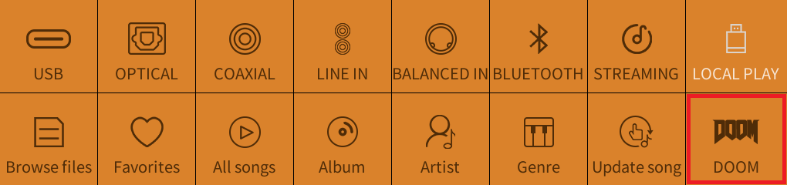
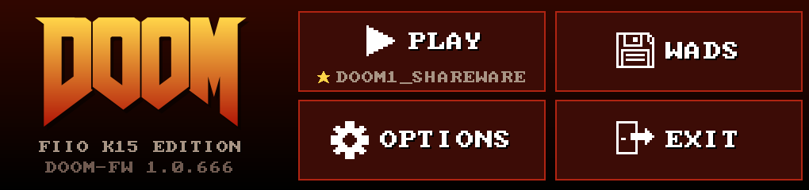
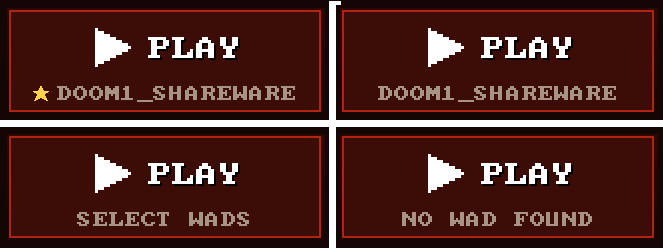
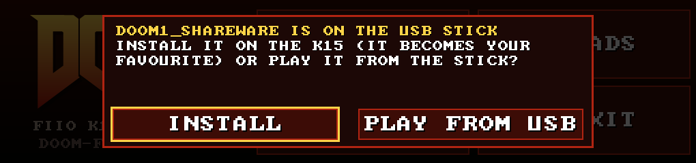
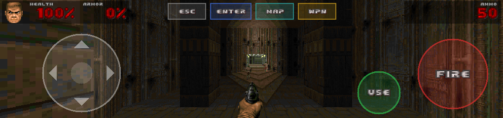
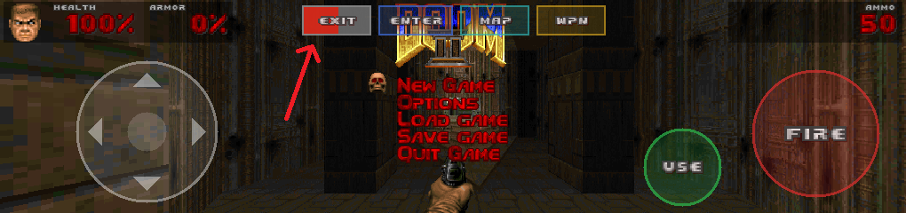

# The DOOM launcher

Picking DOOM on the K15 starts the **DOOM launcher**: a small home menu where you choose a WAD, set up controls and start the game. When you're done, you're back in the stock K15 UI exactly where you left it.

## Starting DOOM

Two ways in, both run the same launcher:

- **Source grid:** swipe right and tap the **DOOM** tile (the last cell, bottom right).

  

- **Knob carousel:** press the menu button, turn the volume knob past LOCAL PLAY to **DOOM**, then push the knob, tap the label, or just wait 3 seconds (the carousel auto-selects, like it does for inputs).

  

## The home menu

- **PLAY**: what it does is shown under it:

  

  - **★ DOOM II** (your favorite, with a yellow star): starts it straight away.
  - **DOOM II** (the only WAD there is): starts it. If it's only on the USB stick, PLAY asks: **INSTALL** (copies it to the K15, makes it your favorite and starts it) or **PLAY FROM USB**. Tap outside the box (or press Esc/B) to cancel.

    

  - **SELECT WADS** (more than one WAD, no favorite): opens the WAD list.
  - **NO WAD FOUND**: tells you how to get one.

  Known IWAD file names show their game name (`doom2.wad` is DOOM II, `freedoom1.wad` is FREEDOOM PHASE 1, ...). Anything else shows its file name, which is why the screenshots say DOOM1_SHAREWARE.
- **WADS**: play, install and delete WADs, and pick your favorite. See [WADs](wads.md).
- **OPTIONS**: touch layout, controls, keyboard and gamepad bindings, cheats, music volume, FPS counter. See [options](options.md).
- **EXIT** goes back to the K15 UI.

The menu works with touch (buttons fire when you lift your finger, so slide off to cancel), a keyboard or a gamepad: arrows/D-pad move the yellow focus frame, left/right change values, Enter/A selects, Esc/B goes back.

## How to play

1. **Press PLAY.**
2. **No WAD yet?** Copy a `.wad` file to the root of a USB stick and plug it into the back USB-A port. The shareware `doom1.wad` is fine, so is your own `doom.wad` or `doom2.wad`, or the free [Freedoom](https://freedoom.github.io/). More in [WADs](wads.md).
3. **Controls:** use the touch controls, or plug in a **USB keyboard or gamepad** (any time, even mid-game). The touch controls hide as soon as you use a key or button, and come back when you touch the screen.
4. **To quit**, use DOOM's own menu (*Quit Game*, which takes you back to the launcher), or **hold ESC for 3 seconds** to go straight back to the K15 UI.

### Touch controls

With the default CLASSIC layout:

| Control | Does |
|---|---|
| Joystick (left) | Move and turn |
| FIRE (big disc, right) | Fire. In DOOM's menu it also selects |
| USE (small disc) | Open doors, flip switches |
| Tap the middle of the view | Use, too |
| ESC | DOOM's menu. **Hold 3 s** to exit to the K15 UI |
| ENTER | Select in menus, answers DOOM's "press Y" prompts |
| MAP | Automap. **Hold** for the [cheat menu](options.md#cheat-menu) |
| WPN | Cycle through weapon slots 1–7 |

Other layouts (left-handed, minimal, big) are in [options](options.md#layout).

### Keyboard and gamepad

| | Keyboard | Gamepad (XInput) |
|---|---|---|
| Move | ↑ ↓, W S | Left stick (sideways strafes), D-pad |
| Turn | ← → | Right stick, D-pad |
| Strafe | A D, or Alt + ← → | Left stick sideways |
| Fire | Ctrl | RT or A |
| Use | Space | X or B |
| Run | Shift | LT or L3 |
| Weapons | 1–7, `[` `]` | LB / RB |
| Automap | Tab | Y or Back |
| Menu | Esc | Start |
| Exit to the K15 UI | hold Esc 3 s | hold Start 3 s |

Most of these can be rebound. Details in [options](options.md#keyboard).

### Exiting

Hold ESC (the touch pill, keyboard Esc or pad Start). The press opens DOOM's menu first; keep holding. The pill fills red and says EXIT. After 3 seconds you're back in the K15 UI, with your previous input restored.

### Front panel

Only two front-panel controls reach DOOM: the knob push acts as USE, and the menu button does nothing. Turning the knob still changes the volume. The IR remote does nothing in DOOM.

## Under the hood

What the launcher does for you behind the scenes:

- **Switches the audio input.** DOOM's sound goes through the K15's own player path, which needs the *Local Play* or *Streaming* input. If you're on another input (USB, optical, …) the launcher switches to Local Play, and switches back when you quit. If a paused song still holds the audio device, it briefly flips between Local Play and Streaming so the player lets go. That stops the paused song.
- **Borrows the screen and the touch panel.** DOOM draws on a spare framebuffer page and grabs the inputs, so no tap ever reaches the stock UI underneath. On exit it hands both back. The volume knob keeps working the whole time.
- **Runs one DOOM at a time.** Tapping the tile twice won't start two.
- **Logs** to `/usr/data/doom/launch.log` (the launcher) and `/usr/data/doom/doom.log` (the engine). Settings and saves live in `/usr/data/doom/` too, so they survive reboots and firmware updates.
