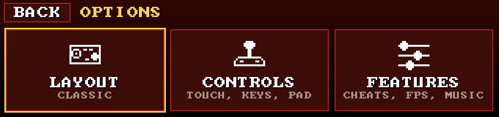
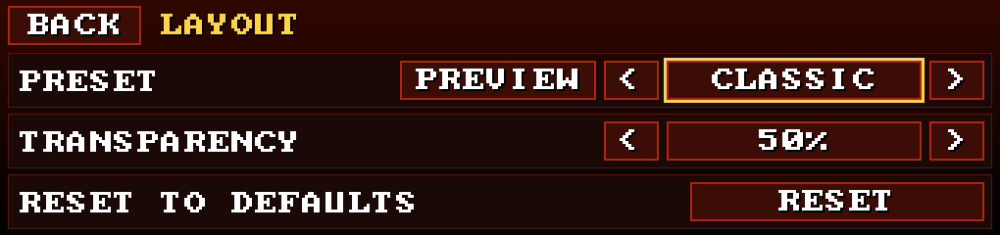
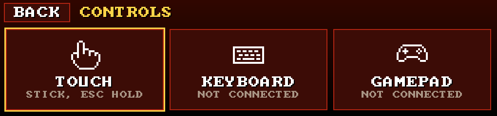
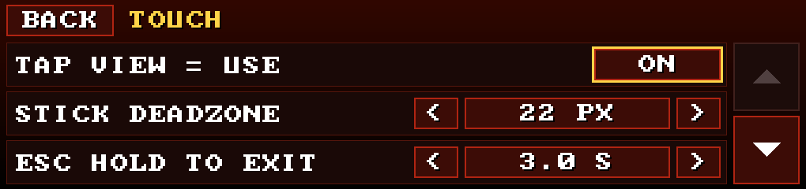
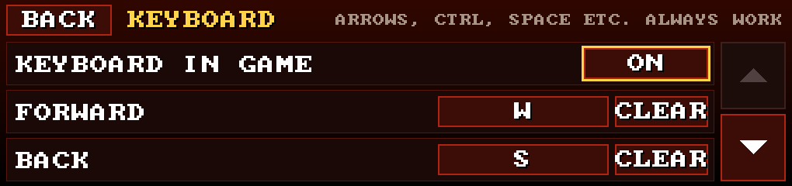
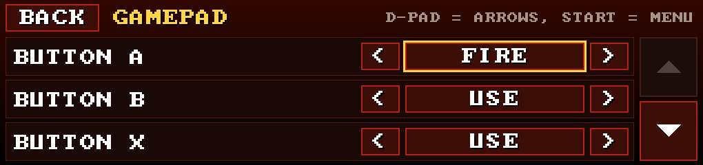
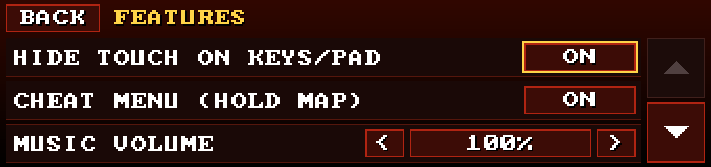
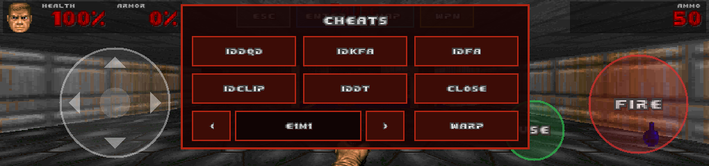

# Options

**OPTIONS** on the home screen has three pages: LAYOUT, CONTROLS and FEATURES. Settings are saved on the K15 (`/usr/data/doom/k15.conf`) when you leave a page, and every list ends with **RESET TO DEFAULTS** in case you get creative.

Navigating: tap, or use arrows/D-pad to move, left/right to change a value, Enter/A to select, Esc/B to go back.

## LAYOUT

- **PRESET**: the touch layout.
  - **CLASSIC**: joystick left, FIRE and USE right, ESC / ENTER / MAP / WPN at the top.
  - **LEFTY**: CLASSIC, mirrored.
  - **MINIMAL**: joystick, FIRE and ESC. Tap the view to use. FIRE also selects in DOOM's menu, so you don't need ENTER.
  - **BIG**: CLASSIC with bigger controls, for thumbs of all sizes.
- **PREVIEW**: try the layout on a dummy screen. Touch the controls to see them light up; tap the middle to go back.
- **TRANSPARENCY**: 0 % is the most solid, 50 % is the default, 90 % is nearly invisible.

## CONTROLS

Three tiles. KEYBOARD and GAMEPAD say whether one is **CONNECTED** right now:

### TOUCH

| Option | Default | What it does |
|---|---|---|
| TAP VIEW = USE | on | Tapping the middle of the view opens doors |
| STICK DEADZONE | 22 px | How far you move the joystick before it reacts (10–50) |
| ESC HOLD TO EXIT | 3 s | How long to hold ESC (or keyboard Esc / pad Start) to exit (1–6 s) |
| PRESS FLASH | on | A white flash on a touch control when you press it |

### KEYBOARD

Any USB keyboard works, wired or with a 2.4 GHz dongle. Plug it into the back USB-A port, any time.

These keys **always** work: arrows, Ctrl (fire), Space (use), Shift (run), Alt (strafe modifier), 1–7 (weapons), Tab (automap), Esc (menu; hold 3 s to exit).

On top of that, each action can have **one extra key**. Tap the key name, press a key, done. The defaults:

| Action | Extra key |
|---|---|
| Forward / back | W / S |
| Strafe left / right | A / D |
| Previous / next weapon | `[` / `]` |

You can also set extra keys for turning, fire, use, run, strafe and the automap. **CLEAR** removes one. Extra keys only act in a level with DOOM's menu closed, and their letters still count as typed, so `iddqd` and save names work. **KEYBOARD IN GAME** off makes DOOM ignore the keyboard in game (it stays grabbed, so nothing leaks to the stock UI). Volume keys do nothing.

### GAMEPAD

XInput pads work (an 8BitDo in its default mode, Xbox-style pads). The K15 kernel has no driver for those, so DOOM talks to the pad over raw USB itself. Regular HID/evdev pads should work too, but nobody tried one.

Fixed: left stick moves (sideways = strafe, analog), right stick turns (analog), D-pad = arrows, Start = menu (hold 3 s to exit). Every other button can be set to NONE, FIRE, USE, RUN, STRAFE, PREVWPN, NEXTWPN, MAP or MENU. Defaults:

| Button | Action |
|---|---|
| A, RT | FIRE |
| B, X | USE |
| LB / RB | PREVWPN / NEXTWPN |
| LT, L3 | RUN |
| Y, BACK | MAP |
| R3 | NONE |

In DOOM's menu: D-pad or stick to move, A selects (and answers "y"), B goes back (and answers "n").

Keyboards and pads can be plugged in and out mid-game. There's only one USB host port (the back USB-A), so a stick, a keyboard and a pad at the same time needs a hub. That's untested.

## FEATURES

| Option | Default | What it does |
|---|---|---|
| HIDE TOUCH ON KEYS/PAD | on | Hide the touch controls when you use a keyboard or pad. The next touch brings them back (that touch does nothing else) |
| CHEAT MENU (HOLD MAP) | on | See [below](#cheat-menu) |
| MUSIC VOLUME | 100 % | OPL music level, 0–400 %. Sound effects aren't affected |
| SHOW FPS | off | Frames per second, bottom right |
| DEBUG LOG | off | Verbose `/usr/data/doom/doom.log`, for bug hunting |

## Cheat menu

Typing `idkfa` on a touchscreen is no fun, so: in a level, **hold MAP** (or the pad's **BACK**) for 0.6 s. The game pauses and a panel opens:

| Button | Cheat |
|---|---|
| IDDQD | God mode |
| IDKFA | All weapons, ammo, armor and keys |
| IDFA | All weapons, ammo and armor, no keys |
| IDCLIP | Walk through walls (DOOM 1 knows it as `idspispopd`, the one cheat nobody can spell) |
| IDDT | Full automap (opens the automap) |
| `<` level `>`, WARP | Pick a level (MAP01, or E1M1 in DOOM 1), then jump to it |
| CLOSE | Back to the game |

A short tap on MAP still opens the automap. Tap outside the panel, or press B/Esc, to close it. Don't want the temptation? Switch it off under FEATURES.

## Settings for nerds

Everything above is stored as `KEY=VALUE` lines in `/usr/data/doom/k15.conf`. A `k15.conf` on the root of a USB stick overrides it for one run (see [WADs](wads.md#overrides-from-the-stick)). The full key table is in the [design notes](../technical/design.md#52-home-menu-options-and-settings--stage-3). Two useful extras that aren't in the menu: `K15_TOUCH` (0–4, alternative touch-panel orientations, in case a unit's touch is rotated) and `K15_SINGLEBUF=1` (use one spare framebuffer page instead of two, i.e. no double buffering; for debugging).
