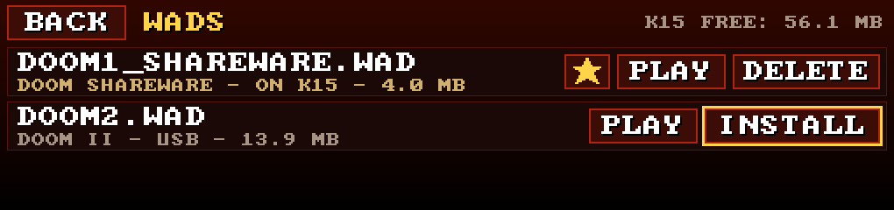
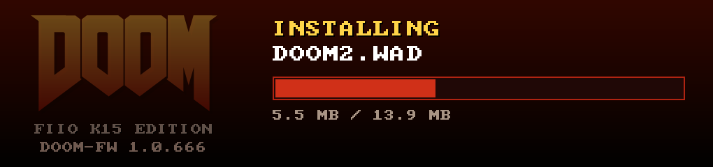
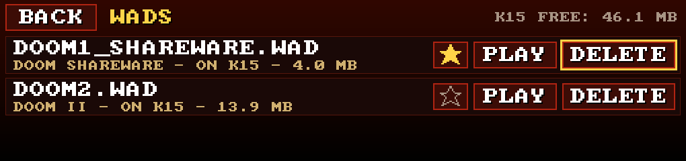
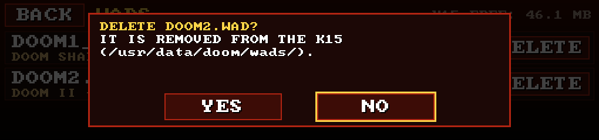
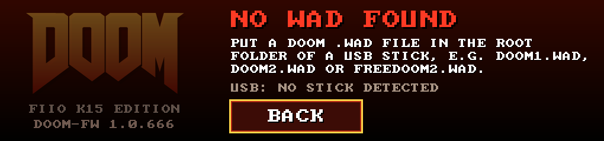

# WADs

DOOM needs a WAD: the file with the levels, monsters and music. None is included (id Software would like a word). Bring your own:

- the shareware **`doom1.wad`** (free, episode 1),
- your own **`doom.wad`**, **`doom2.wad`**, **`plutonia.wad`** or **`tnt.wad`** (from a DOOM you own, for example the Steam or GOG release),
- **[Freedoom](https://freedoom.github.io/)** (`freedoom1.wad`, `freedoom2.wad`), free and open,
- add-on **PWADs** (custom levels), played on top of a matching IWAD.

The file name doesn't change what a WAD is: the launcher looks inside the file to find out. (The name does set the label shown in the menu, and add-ons look for their base game by the usual IWAD file names, see below.)

## Playing from a USB stick

Copy `.wad` files to the **root** of a FAT32/exFAT USB stick and plug it into the back USB-A port. Open **WADS**. Stick WADs show up within a couple of seconds:

Each row has:

- **☆** (installed WADs only): make this your **favorite**. PLAY on the home screen starts it straight away and shows it with a yellow star. The star turns yellow here too. Tap it again to clear it.
- **PLAY**: start this WAD now.
- **INSTALL** (on the stick) or **DELETE** (on the K15).

The header shows the free space on the K15.

## Installing to the K15

Tired of carrying the stick around? **INSTALL** copies the WAD to the K15 (`/usr/data/doom/wads/`), with a progress bar:

A short message confirms it when it's done. Afterwards the WAD shows up once, as ON K15, with or without the stick: a stick file with the same name as an installed WAD is hidden. Now you can star it.

Only one WAD around, and it's on the stick? PLAY on the home screen offers **INSTALL** or **PLAY FROM USB** (see [the home menu](README.md#the-home-menu)). INSTALL copies it, makes it your favorite and starts it.

The K15 has about 50 MB free for this. Install refuses if there's less than the WAD's size plus 5 MB, and tells you both numbers. `doom2.wad` (14.6 MB) fits fine. Your 300 MB megawad doesn't: play that one from the stick.

## Deleting

**DELETE** removes an installed WAD after a YES/NO check (with a keyboard or pad the focus starts on NO, because accidents happen):

Your savegames for that game are kept. If it was your favorite, it isn't any more. If the stick has the same file, its row comes back.

## Add-on WADs (PWADs)

A PWAD only has new levels, so it needs a base game (IWAD). The launcher picks one for you:

- **DOOM II maps** get `doom2.wad` first, then `freedoom2.wad`, `plutonia.wad`, `tnt.wad`.
- **DOOM 1 maps** get `doom.wad`, `doomu.wad` or `freedoom1.wad`.
- Installed copies win over stick copies.
- The shareware WAD is never used as a base.

No matching IWAD? The row says **NEEDS AN IWAD** and PLAY is disabled.

## NO WAD FOUND

No WAD on the K15 and no stick? You get this:

Plug in a stick with a WAD and the list appears by itself, no need to go back.

## Savegames and settings

Saves go to `/usr/data/doom/savegame/<wad>/`, one folder per game, so your DOOM and DOOM II saves don't collide. DOOM's own settings are in `/usr/data/doom/default.cfg`. They all survive reboots and firmware updates.

### Overrides from the stick

Two optional files in the root of the stick are applied for that run only:

| File | Effect |
|---|---|
| `doom.cfg` | DOOM settings (vanilla `default.cfg` format), applied on top of the saved config |
| `k15.conf` | launcher settings, `KEY=VALUE`, applied on top of the saved ones. The menu then shows "SET BY THE USB STICK K15.CONF THIS RUN". Keys are listed in [the design notes](../technical/design.md#52-home-menu-options-and-settings--stage-3) |

Unknown keys are ignored. Nothing from the stick is saved.
