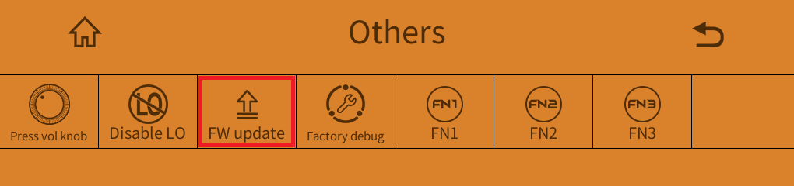
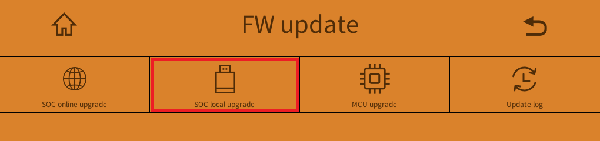
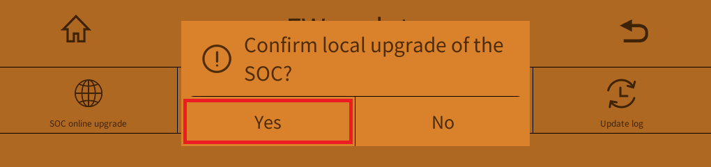
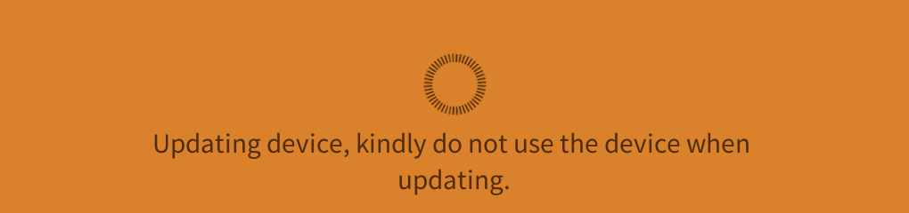
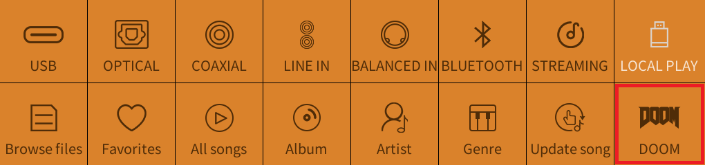

# Flashing

Goal: plug in a USB stick, press a few buttons, and watch your K15 boot with a DOOM animation. You need the zip from [building](building.md), a USB stick and about 5 minutes.

## Simple guide

### 1. Prepare the USB stick

- Format it as **FAT32 or exFAT**, with at least **250 MB** free.
- Copy `out/K15_update_<date>_<time>_v160.zip` to the **root** of the stick. Don't unzip it and don't rename it.
- Make sure it's the **only** `K15_update_*.zip` on the stick.
- Optional but recommended: copy a WAD to the root too (for example the shareware `doom1.wad`), so you can play right after the reboot.

Plug the stick into the **USB-A port on the back** of the K15.

### 2. Start the update

Open *Settings → Others*:



Tap **FW update**:



Tap **SOC local upgrade** and answer **Yes**:



### 3. Wait

The K15 first unpacks the zip onto the stick:



Then it reboots into its updater and writes the new firmware. This takes a few minutes. **Don't cut the power.** Go get a coffee. Or a shotgun.

When it's done, the K15 restarts and plays the new boot animation:

### 4. Check

Swipe right to open the source grid. There's a DOOM tile in the bottom-right corner:



That's it. Next: [play DOOM](doom/README.md).

---

## Advanced

### USB stick rules

- **FAT32 or exFAT.** The K15 also reads NTFS for music, but the updater was only tested with FAT32/exFAT.
- **Root of the stick, zipped, original name.** The K15 looks for `K15_update_…v<N>.zip` in the root and unpacks it itself (into `K15_update_images/` on the stick; you can delete that folder afterwards).
- **Only one `K15_update_*.zip`.** The K15 reads the version from the first `v` in the name. With several zips it compares their versions at a fixed position in the name that assumes the official `K15_update_YYYYMMDD_vNNN.zip` pattern. Our names have an extra `_HHMM`, so with several zips it may pick the wrong one. With one zip that comparison isn't used.
- The updater checks the MD5 of every file and every 1 MB chunk before it writes anything. A corrupt copy is refused, not flashed.

### What gets written

Only the main OS: the stock kernel (copied verbatim from your zip) and the new rootfs. The **recovery partition is never written**: the package says `recovery_version=4`, the version already installed, so the updater skips it. `/usr/data` (your settings, WADs and saves) isn't touched either.

### Why does the package say v160?

The package is labeled **v160**, so the updater treats it as an update. But the rootfs inside it is still FiiO's v159 (plus DOOM), so *Settings → About* and the system keep reporting **v159**. The upside: FiiO's next official update (v160 or later) installs normally over it, and removes DOOM. Same for [going back to stock](restore.md).

### Is it really installed?

If you have adb (see [development](technical/development.md)), this prints the build:

```sh
adb shell cat /etc/homebrew_version
```

```text
HOMEBREW=doom
BASE=v159
BUILT=2026-10-31T17:23:...Z
DOOMFW=1.0.666
BOOTANIM=melt
```

### If something goes wrong

- **The K15 doesn't pick up the update, or refuses it:** go through the [USB stick rules](#usb-stick-rules) above. The usual suspects are a stick that isn't FAT32/exFAT, a zip that was unzipped or renamed, or a second `K15_update_*.zip` on the stick. The *Update log* tile in the FW update menu may tell you more.
- **The updater complains about the file:** the zip is probably a bad copy. Copy it to the stick again (or rebuild it). The updater checks every MD5 and refuses corrupt files before writing anything.
- **No DOOM tile after the reboot:** check that you flashed the zip from `out/` and not FiiO's own. With adb, `cat /etc/homebrew_version` should say `HOMEBREW=doom` (see above).
- **You'd rather not have DOOM after all:** [going back to stock](restore.md). The recovery partition is never written, so the updater you used is still there for the way back.
